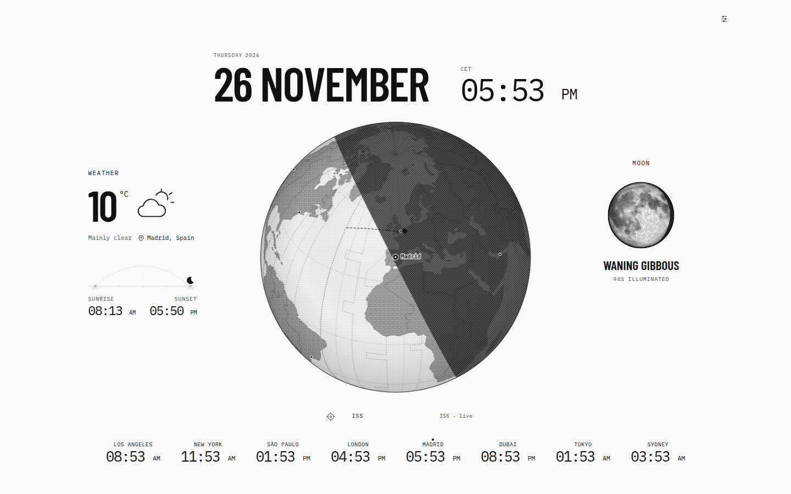

# Home New Tab



## Install in Chrome on macOS

1. Open the [v0.0.5 release](https://github.com/cris7ian/home-new-tab/releases/tag/v0.0.5) while signed in to GitHub.
2. Download **`home-new-tab-v0.0.5.zip`**. Extract it to a folder you plan to keep.
3. Open `chrome://extensions` in your regular Chrome profile.
4. Enable **Developer mode** and select **Load unpacked**.
5. Select the extracted **`extension`** folder. It contains `manifest.json`.
6. Press **⌘T**. If Chrome asks whether to keep the change, select **Keep it**.

Select a city clock to rotate the globe and view that city’s weather and sun. Select the target icon to return to your location, or select **ISS** to follow the station. In Weather, choose **Use my location** to let Chrome detect where you are, or pick a city manually. Chrome may show a location permission warning at installation. Home does not request device coordinates until you choose **Use my location** in the dashboard. Incognito new tabs are not overridden.

Open **Settings → Theme** to choose **System**, **Light**, or **Dark**. System follows your device appearance.

The Sun moves along the arc in daylight. At night, a crescent marks the sunset or sunrise end. A city selected manually stays selected until you choose **Use my location** again. Nearby city labels are resolved on-device and are approximate.

The folder must stay on your Mac. To update, replace its files with the newer version and click **Reload** at `chrome://extensions`.

## Build the extension and previews

Run `python3 experiments/build_globe.py`. This updates the unpacked `extension/` package and the pages in `experiments/preview-local/`, but does not change the public site. `globe.html` is the web release artifact. The extension contains its scripts, fonts and map; weather, city search and ISS positions need an internet connection. No account or API keys are needed to use it.

## Website

The date and clock use the device timezone. Weather and solar times follow the selected city, or your location when no other city is selected.

## Preview

```sh
python3 experiments/build_globe.py
python3 -m http.server 4174 --bind 127.0.0.1 --directory experiments/preview-local
```

Open `http://localhost:4174/globe.html`. To preview on a trusted local network, bind the server to its LAN address instead. Browser permissions disable automatic location on plain HTTP except for loopback; use city search in that case. The page rounds your coordinates before sending them to the weather provider. Your last location choice stays in your browser.

This project has no server-side application or runtime build dependencies. It does not change browser new-tab settings.

## Production

`https://home.salsaparapizza.com/` serves `public/` through production-server's Caddy origin. The site was registered with `newsite home --from [production-directory]`.

**`public/` is live.** Verify `experiments/preview-local/globe.html` before atomically replacing the live `public/index.html`. Do not run the legacy `build.py` against the production checkout.

## Sources

- [Natural Earth](https://www.naturalearthdata.com/downloads/10m-cultural-vectors/timezones/) (public domain). Boundaries are a simplified reference layer; city clocks use the browser's timezone rules.
- [Open-Meteo](https://open-meteo.com/) for weather and place search.
- [GeoNames cities5000](https://download.geonames.org/export/dump/) ([CC BY 4.0](https://creativecommons.org/licenses/by/4.0/)) for on-device nearby place labels. The bundled extract retains names and simplified coordinates.
- [Astronomy Engine](https://github.com/cosinekitty/astronomy) 2.1.19 (MIT) for solar events and lunar phases.
- [NASA’s Scientific Visualization Studio](https://svs.gsfc.nasa.gov/5001/) for the Lunar Reconnaissance Orbiter Moon mosaic. Resized and contrast-adjusted for the phase illustration.
- [Bodoni Moda](https://fonts.google.com/specimen/Bodoni+Moda) and [DM Mono](https://fonts.google.com/specimen/DM+Mono), under the SIL Open Font License.
